

# UT Bot Scanner (MetaTrader 5 and MetaTrader 4)

A scanner indicator that shows the **UT Bot** buy or sell side of many symbols and timeframes in one panel on your chart,
and sends an alert when a new signal appears.

> **This is a showcase repository: documentation and images only. There is no source code here.** The product is sold on
> the MQL5 Market. The free single-chart indicator it builds on has public source:
> [allanninal/ut-bot-signal-alerts](https://github.com/allanninal/ut-bot-signal-alerts).

**Website:** [allanninal.dev/mql5 (indicators)](https://www.allanninal.dev/mql5/#indicators) · [MT4 editions](https://www.allanninal.dev/mql5/#mt4) · [allanninal.dev](https://www.allanninal.dev)
· **Contact:** message me on [LinkedIn](https://www.linkedin.com/in/allanninal/).

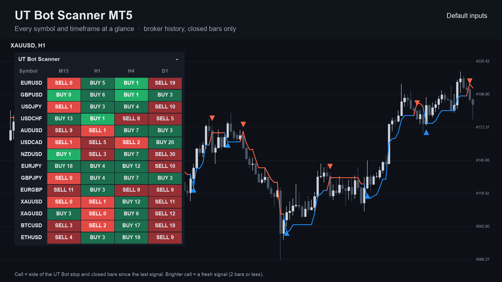

## Get it on the MQL5 Market

| Product | Platform | Price | Link |
|---|---|---|---|
| **UT Bot Scanner** | MT5 | paid | <https://www.mql5.com/en/market/product/201600> |
| **UT Bot Scanner Pro MT4** | MT4 | paid | <https://www.mql5.com/en/market/product/202391> |
| UT Bot Signal Alerts (single chart, source on GitHub) | MT5 | free | <https://www.mql5.com/en/market/product/201607> |
| UT Bot Signal Alerts MT4 (single chart, source on GitHub) | MT4 | free | <https://www.mql5.com/en/market/product/202304> |

The scanner is standalone: you do not need to install the free indicator to use it. Details, current price and the
Strategy Tester demo are on the Market pages.

## What it does

- A panel on the chart with **symbols as rows and timeframes as columns**.
- **In each cell:** `BUY` or `SELL` (the side of the UT Bot stop line) and how many closed bars ago the last signal came,
  for example `BUY 3`.
- A **brighter cell** when the last signal is recent (you choose how many bars count as fresh).
- **Click a cell** to open that symbol and timeframe.
- **Alerts:** pop-up (on by default), sound, push notification and e-mail, each switched separately. Nothing is sent while
  history loads, never twice for the same cell and bar, and not in the Strategy Tester.
- **Closed bars only.** A cell does not change after its bar has closed. It places no orders.
- Options match the free indicator: key value, ATR period, Heikin Ashi source, EMA trend filter.
- Works on any symbol with history, including gold and crypto.

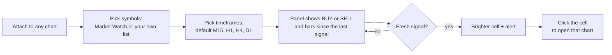

### The grid at a glance

Each cell is one symbol on one timeframe. You read the market across the whole list in a single look instead of
flipping through charts.

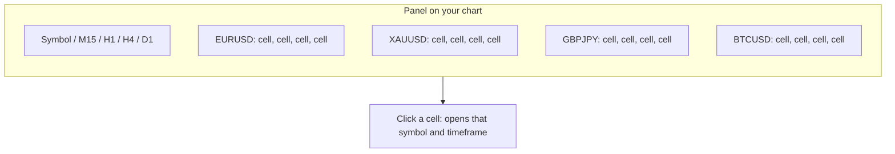

### What a cell can show

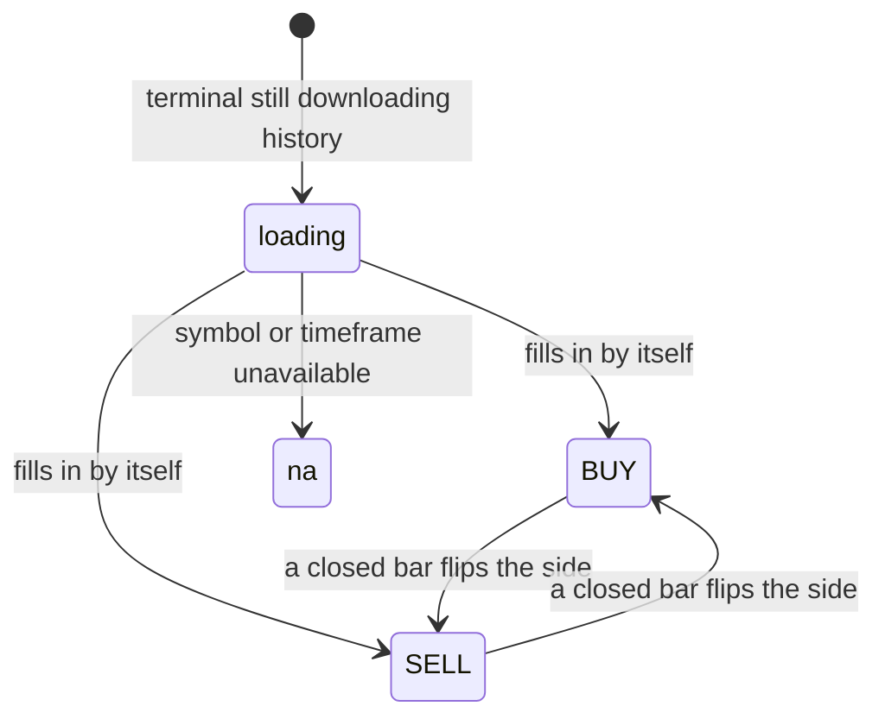

| | |
|---|---|
| 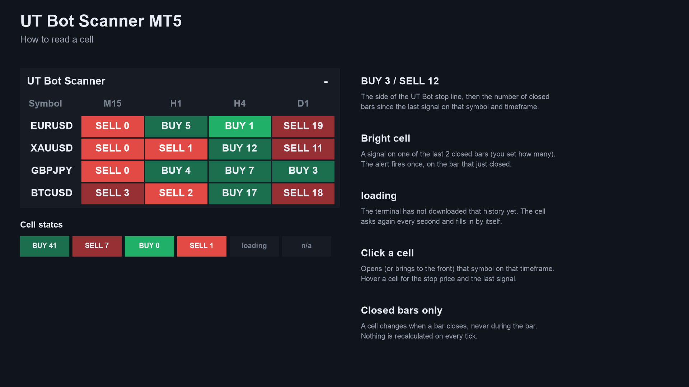 | 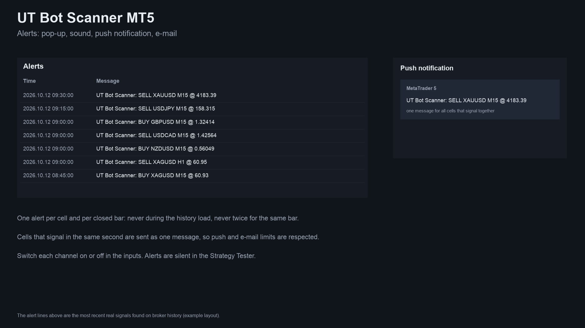 |
| 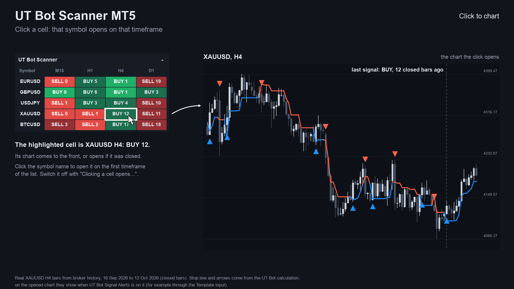 | 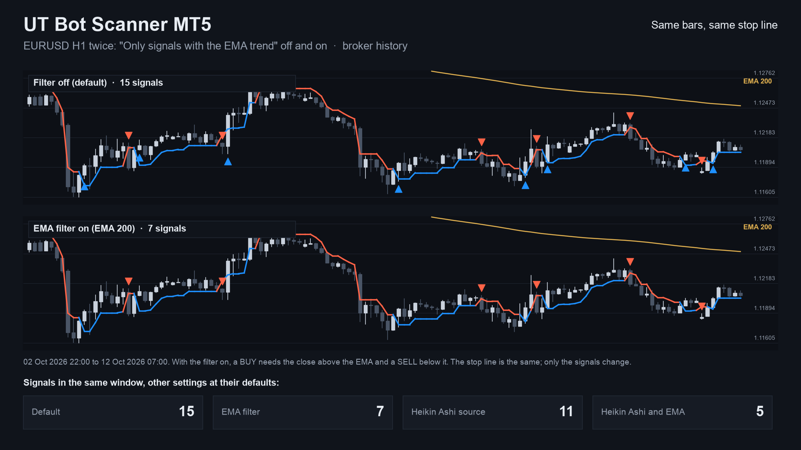 |

MT4 edition screenshots: [panel on a chart](images/mt4/01-scanner-on-chart.png), [how to read a cell](images/mt4/02-how-to-read-a-cell.png).
Some screenshots are illustrations built from broker history, not terminal captures.

## Who it is for

Traders who use the UT Bot rule on several symbols. If you watch one chart, the free
[UT Bot Signal Alerts](https://www.mql5.com/en/market/product/201607) is enough.

## Why it was built

- The UT Bot is one of the most copied TradingView scripts; the free single-chart indicator covers one chart at a time.
- Our October 2026 market research (MQL5 Market, forums, freelance boards) found multi-symbol scanners are a recurring
  want: traders hire scanner gigs at roughly 45 to 145 USD, and a market-wide screener was an identified gap.
- Design rule carried over from the free indicator: trust. Cells use closed bars only, so what you saw does not change.

## Starting settings

Four starting points, from the listing. They differ in how many signals they give, not in profit; none is optimised.
Signals per month are a code count on broker history (October 2023 to October 2026, EURUSD, GBPUSD, USDJPY, XAUUSD, closed
bars), not a trading result.

| Timeframe | Key value | ATR period | Signals per month |
|---|---|---|---|
| M15 | 2.0 | 10 | about 95 to 115 |
| H1 | 1.0 (default) | 10 | about 57 to 62 |
| H4 | 1.0 | 10 | about 15 |
| D1 | 1.0 | 10 | about 2 to 3 |

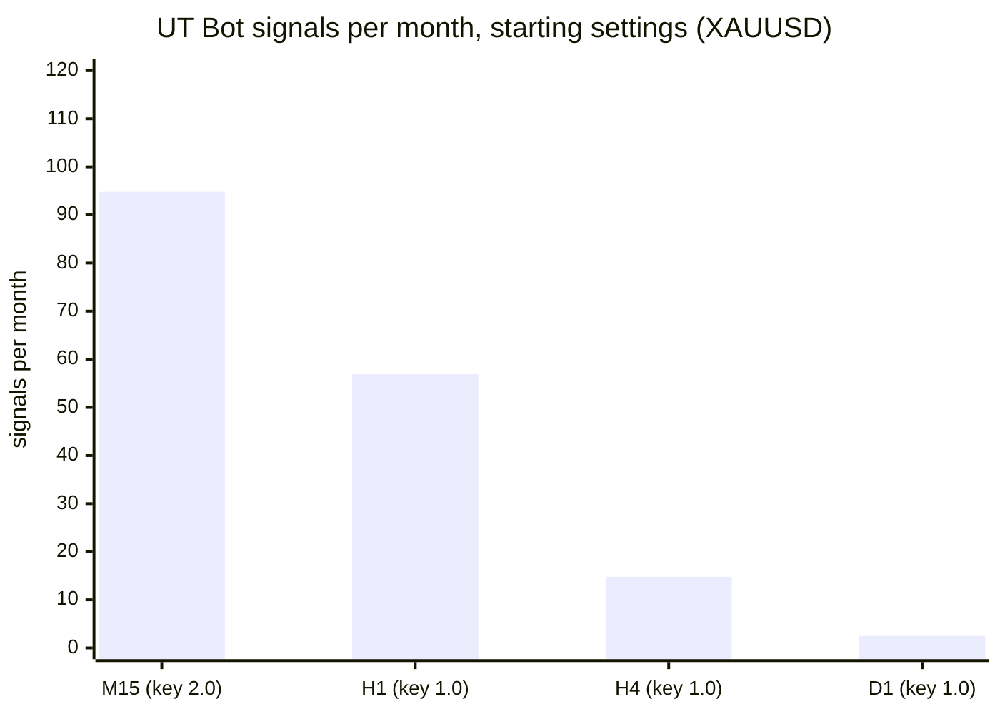

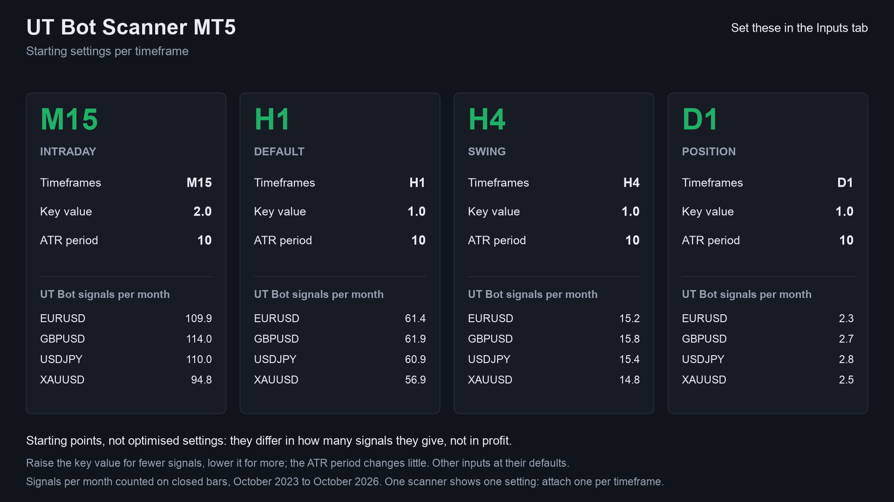

## How it was checked (results)

Every cell value was compared with an independent Python calculation. Results of the MT4 edition's final run (MetaTrader 4
Strategy Tester, 4 symbols, M15 / H1 / H4 / D1):

| Check | Result |
|---|---|
| Test files compared | 156, all pass |
| Values compared | 12,835,040, 0 differences |
| Panel counts vs the test's own cells, every tick | 8,991,498 ticks matched |
| Excluded | the first tick of each run, before the cells have loaded (12 start-up differences) |
| Cells using the forming bar | none; live runs used closed bars only |

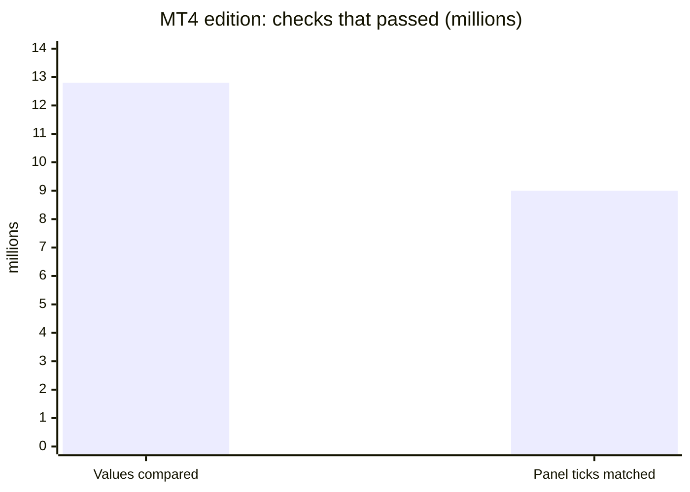

The MT5 edition uses the same calculation; its Market listing states the same code check. These are code checks, not
trading results.

## Honest limits

- A scanner shows the state of a technical rule. It does not predict the market, and past signals are no indication of
  future results. No profit or accuracy claim is made.
- It is an indicator: it places no orders and manages no risk.
- It needs the terminal running to alert, and push needs your MetaQuotes ID set up in the terminal.
- The source is not published; this repository documents what the product does and the results of its checks.

## Free vs paid

| | UT Bot Signal Alerts (free) | UT Bot Scanner (paid) |
|---|---|---|
| Scope | one chart | many symbols x timeframes in one panel |
| Output | line and arrows on the chart | BUY / SELL cells with bars since the last signal |
| Alerts | pop-up, sound, push, e-mail | pop-up, sound, push, e-mail |
| MT5 | [201607](https://www.mql5.com/en/market/product/201607) | [201600](https://www.mql5.com/en/market/product/201600) |
| MT4 | [202304](https://www.mql5.com/en/market/product/202304) | [202391](https://www.mql5.com/en/market/product/202391) (Pro MT4) |
| Source | [public on GitHub](https://github.com/allanninal/ut-bot-signal-alerts) | not published |

## Credits

The UT Bot idea, an ATR trailing stop, is by Yo_adriiiiaan, from an original idea by HPotter; the TradingView "UT Bot
Alerts" script is by QuantNomad.

---

**Website:** [allanninal.dev/mql5](https://www.allanninal.dev/mql5/#indicators) · [MT4](https://www.allanninal.dev/mql5/#mt4) · [allanninal.dev](https://www.allanninal.dev)
· Questions: message me on [LinkedIn](https://www.linkedin.com/in/allanninal/). All rights reserved, see [LICENSE](LICENSE).
